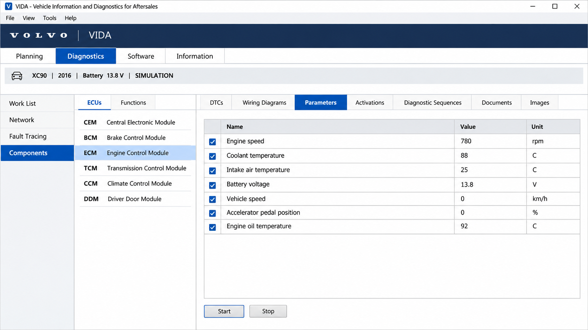
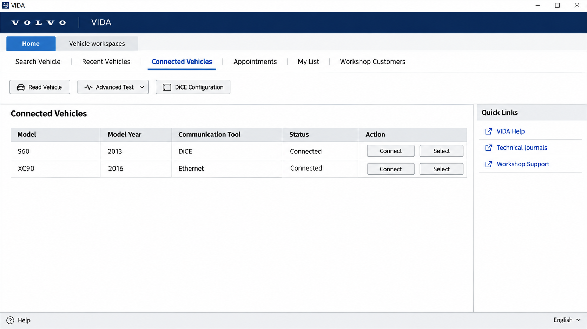
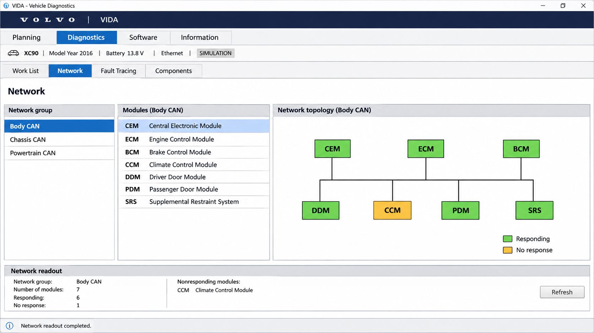

# Volvo Vida Diagnostics - Python Foundations For Volvo Vehicle Diagnostics

Volvo Vida Diagnostics is a Volvo Vida organization project for studying CAN communication, ISO-TP transport, UDS services, J2534 connections, and selected Volvo DBC data.

[](https://volvo-vida.github.io/volvo-vida-diagnostics/volvo-vida)

## SocketCAN Userspace Utilities And Tools



Volvo Vida Diagnostics provides Python components that can work with SocketCAN-compatible environments. The [CAN interface](can/interface.py) selects a bus implementation, while the [SocketCAN backend](can/interfaces/socketcan/socketcan.py) handles Linux CAN communication.

### Basic Tools To Display, Record, Generate And Replay CAN Traffic

The retained CAN modules support the foundations needed to:

- Represent CAN frames with [Message](can/message.py).
- Send and receive traffic through [Bus](can/bus.py).
- Dispatch frames with [Notifier](can/notifier.py).
- Process frame events with [Listener](can/listener.py).
- Schedule cyclic traffic through [Broadcast Manager](can/broadcastmanager.py).
- Use an isolated [Virtual Bus](can/interfaces/virtual.py) during development.
- Calculate timing parameters with [Bit Timing](can/bit_timing.py).

### ISO-TP Tools

The [ISO-TP protocol](isotp/protocol.py) provides transport-layer handling for diagnostic payloads that exceed one CAN frame. Volvo Vida Diagnostics includes address definitions, CAN-message abstractions, socket options, error types, and transport utilities.

- Single frames carry short requests and responses.
- First and consecutive frames transport longer messages.
- Flow-control frames regulate segmented transfers.
- Physical and functional addressing identify diagnostic destinations.

### CAN Bus Measurement And Testing

Volvo Vida Diagnostics can form the transport foundation for logging, filtering, replay, bus-load analysis, and controlled diagnostic testing.

## Additional Information

Its primary layers are:

| Layer | Purpose | Implementation |
|---|---|---|
| CAN | Frame transport and bus abstraction | [can](can/__init__.py) |
| ISO-TP | Segmented diagnostic transport | [isotp](isotp/__init__.py) |
| UDS | Requests, responses, services, and clients | [udsoncan](udsoncan/__init__.py) |
| Pass-through | J2534 diagnostic connectivity | [j2534.py](udsoncan/j2534.py) |
| Vehicle data | Selected reverse-engineered Volvo CAN definitions | [Volvo V40 DBC](opendbc/dbc/volvo_v40_2017_pt.dbc) and [Volvo V60 DBC](opendbc/dbc/volvo_v60_2015_pt.dbc) |

Volvo Vida, Volvo Vida Diagnostics, official volvo vida, volvo vida software, volvo vida service information, volvo-diagnostics, vehicle-diagnostics, ecu-diagnostics, obd2, j2534, can-bus, automotive-software

## Notes

The API separates physical CAN communication, ISO-TP transport, and UDS application services. A bus receives CAN frames, ISO-TP assembles diagnostic payloads, and the UDS client interprets requests and responses.

A typical data path is:

```text
Diagnostic client
       │
       ▼
UDS request and response handling
       │
       ▼
ISO-TP segmentation and flow control
       │
       ▼
CAN interface, SocketCAN, virtual bus, or J2534
       │
       ▼
Vehicle network or controlled test environment
```

Volvo Vida Diagnostics does not include an ELM327 parser or emulator in the retained files. An external adapter may still expose vehicle traffic, but its protocol, electrical behavior, and compatibility must be verified independently.

### What is vida on a Volvo?

VIDA means Vehicle Information and Diagnostics for Aftersales. Official Volvo VIDA combines vehicle identification, fault tracing, service procedures, parts information, wiring information, and authorized diagnostic workflows for supported Volvo and Polestar vehicles.

A vida volvo scanner workflow may use compatible communication hardware, while official functions still require the appropriate Volvo services and authorization.

## Subclassing `Protocol`

Transport implementations must preserve clear boundaries between frame parsing, message assembly, addressing, timing, and error handling. The [ISO-TP protocol](isotp/protocol.py) performs segmented transport, while [UDS connections](udsoncan/connections.py) expose that transport to diagnostic clients.

### Parse Frame

A transport receives a CAN message containing an arbitration identifier, payload, timestamp, and frame flags. Invalid frames must be rejected before their data reaches the diagnostic layer.

### Parse Message

A complete diagnostic message may require multiple CAN frames. The ISO-TP layer validates sequence numbers, observes flow-control parameters, assembles payload bytes, and reports transport failures through [ISO-TP errors](isotp/errors.py).

### Normal TX IDs

Diagnostic identifiers depend on the vehicle, network, ECU, addressing mode, and model year. Volvo Vida Diagnostics does not assume that identifiers from one Volvo platform are valid for another.

## Inheritance Structure

```text
CAN interface
├── SocketCAN bus
└── Virtual bus

ISO-TP transport
├── Addressing
├── CAN messages
├── Protocol state
└── Transport-layer sockets

UDS application
├── Client
├── Connections
├── Requests
├── Responses
└── Services
```

## Installation

Use the project metadata in [pyproject.toml](pyproject.toml), dependencies in [requirements.txt](requirements.txt), and packaging configuration in [setup.py](setup.py):

```shell
python -m pip install -e .
```

### How much does a Volvo VIDA subscription cost?

A current volvo vida subscription price cannot be determined from this repository. Volvo controls official access, regional terms, subscription periods, taxes, diagnostic hardware requirements, and any separately charged software operations. The answer to “how much does a volvo vida subscription cost” therefore depends on the market and intended work.

Check the authorized Volvo technical-information channel for the applicable volvo vida price before making a volvo vida purchase.

### How do I get Volvo Vida software?

Obtain official Volvo Vida software through Volvo’s authorized technical-information or dealer channels for your region. Confirm the volvo vida system requirements, supported vehicle coverage, account eligibility, communication-device requirements, and subscription terms before installation.

Do not treat legacy vida 2014d or volvo vida 2014d packages from unofficial sellers as equivalent to current official access.

## Basic Usage



A diagnostic session normally requires a configured CAN or J2534 connection, an ISO-TP address, and a UDS client. Start with read-only requests in a controlled environment.

```python
import can
import isotp
import udsoncan
```

The public foundations are located in:

- [CAN interface selection](can/interface.py).
- [ISO-TP addressing](isotp/address.py).
- [UDS client](udsoncan/client.py).
- [UDS configuration](udsoncan/configs.py).
- [UDS request model](udsoncan/Request.py).
- [UDS response model](udsoncan/Response.py).
- [J2534 connection support](udsoncan/j2534.py).

Never send undocumented write, reset, security, routine-control, download, or coding requests to a live vehicle. Incorrect diagnostic traffic can interrupt modules, change configuration, erase data, or make a vehicle unsafe.

## Documentation

The source modules are typed and organized by protocol layer. Begin with [CAN type definitions](can/typechecking.py), [ISO-TP tools](isotp/tools.py), [UDS tools](udsoncan/tools.py), and [UDS data types](udsoncan/typing.py).

Volvo Vida service information and volvo vida repair information are not embedded in this repository. Volvo Vida wiring diagrams and the volvo vida parts catalog remain functions of authorized Volvo information systems.

## Commands

UDS services model diagnostic operations as request and response objects. Availability depends on the ECU, active session, security state, and vehicle configuration.

| Service Area | Examples |
|---|---|
| Session management | [Diagnostic Session Control](udsoncan/services/DiagnosticSessionControl.py), [Tester Present](udsoncan/services/TesterPresent.py) |
| Identification and data | [Read Data By Identifier](udsoncan/services/ReadDataByIdentifier.py), [Read DTC Information](udsoncan/services/ReadDTCInformation.py) |
| Fault handling | [Clear Diagnostic Information](udsoncan/services/ClearDiagnosticInformation.py), [Control DTC Setting](udsoncan/services/ControlDTCSetting.py) |
| ECU operations | [ECU Reset](udsoncan/services/ECUReset.py), [Routine Control](udsoncan/services/RoutineControl.py) |
| Security | [Authentication](udsoncan/services/Authentication.py), [Security Access](udsoncan/services/SecurityAccess.py) |
| Transfer | [Request Download](udsoncan/services/RequestDownload.py), [Transfer Data](udsoncan/services/TransferData.py), [Request Transfer Exit](udsoncan/services/RequestTransferExit.py) |
| Memory | [Read Memory By Address](udsoncan/services/ReadMemoryByAddress.py), [Write Memory By Address](udsoncan/services/WriteMemoryByAddress.py) |

A volvo vida fault code diagnosis normally requires more than reading a code. Vehicle context, status bits, freeze-frame information, service procedures, wiring checks, and validated repair guidance are also important.

## Common Issues

### Adapter Compatibility

Volvo vida dice compatibility depends on the VIDA generation, vehicle platform, operating environment, driver support, and whether the interface is genuine and supported. Volvo dice, vida dice, volvo vida dice, and volvo vida j2534 are not interchangeable terms for guaranteed compatibility.

Volvo Vida Diagnostics supplies software layers but cannot confirm a particular volvo vida dice for sale listing. Verify electrical isolation, firmware, drivers, protocol support, and vehicle coverage before attaching any interface.

### Addressing And Timing

Incorrect CAN identifiers, ISO-TP addressing, flow-control settings, or UDS timeouts can appear as silent ECUs. Review [addressing](isotp/address.py), [socket options](isotp/tpsock/opts.py), and [address and length formats](udsoncan/common/AddressAndLengthFormatIdentifier.py).

### Vehicle Coverage

The included DBC files cover selected Volvo V40 and V60 powertrain networks. They do not establish broad volvo vida compatible vehicles coverage, and they do not imply volvo vida xc90 support.

### Why is Volvo falling?

If “falling” refers to Volvo’s share price, sales, reputation, or corporate performance, Volvo Vida Diagnostics cannot determine the cause. Those questions require current financial and market evidence rather than vehicle diagnostic traffic.

If “falling” describes a vehicle’s ride height, suspension, battery voltage, engine speed, or another measured condition, begin with a safe mechanical inspection and supported fault diagnosis. Volvo Vida Diagnostics may help transport diagnostic data, but a qualified technician should interpret the measurements using model-specific service information.

## Testing

Run the configured test environment with:

```shell
python -m pytest
```

The project’s test configuration is defined in [tox.ini](tox.ini). Use a virtual CAN interface or bench ECU before testing against a vehicle. CI behavior is documented by the retained [workflow](.github/workflows/ci.yml), while automated security analysis uses [CodeQL](.github/workflows/codeql-analysis.yml).

A sound test plan covers:

- CAN message validation and filtering.
- ISO-TP single-frame and multi-frame transfers.
- Flow-control timing and sequence errors.
- UDS positive and negative responses.
- Request timeouts and unexpected disconnects.
- Functional and physical addressing.
- Read-only behavior before state-changing services.

## Diagnostic Trouble Codes

UDS diagnostic trouble codes include identifiers, status masks, severity information, and ECU-specific context. The [DTC model](udsoncan/common/dtc.py) and [Read DTC Information service](udsoncan/services/ReadDTCInformation.py) provide the relevant protocol structures.

Clearing codes does not repair a fault. Record the complete diagnostic state before using Clear Diagnostic Information, and avoid clearing evidence needed for troubleshooting.

## Data Link And Network Layers

Volvo Vida Diagnostics separates three important protocol layers:

1. CAN carries frames between network nodes.
2. ISO-TP transports diagnostic payloads across one or more CAN frames.
3. UDS defines diagnostic requests, positive responses, and negative responses.

This separation allows the same UDS logic to operate over different compatible connections. It also makes transport failures distinguishable from ECU-level negative responses.

## Advanced Usage

Advanced diagnostic sessions can include dynamic data identifiers, I/O control, memory access, authentication, security access, routine control, and file transfer. These operations may require manufacturer-specific parameters and authorization.

Use [Did Codec](udsoncan/common/DidCodec.py) to define data encoding, [Memory Location](udsoncan/common/MemoryLocation.py) for addressed memory operations, and [Routine](udsoncan/common/Routine.py) for routine-control data. Do not infer proprietary Volvo values from generic UDS definitions.

## Timers

UDS and ISO-TP timing directly affects diagnostic reliability.

| Timing Concern | Purpose |
|---|---|
| Request timeout | Limits how long the client waits for a response. |
| Response pending | Allows an ECU to report that processing continues. |
| Flow-control timeout | Limits waits between ISO-TP transport stages. |
| Separation time | Controls spacing between consecutive frames. |
| Session activity | Keeps a diagnostic session active with Tester Present. |

Vehicle ECUs may use different timing requirements in default, extended, and programming sessions.

## Available Interfaces

Volvo Vida Diagnostics retains two CAN backends and a UDS J2534 connection:

- SocketCAN for supported Linux CAN interfaces.
- Virtual CAN for isolated development and tests.
- J2534 for compatible pass-through environments.

The repository does not include DiCE drivers, ELM327 emulation, Bluetooth transport, serial OBD-II parsing, or TCP diagnostic forwarding.

## DBC File Basics



A DBC file describes how CAN message bits map to signals, scaling factors, offsets, units, transmitters, and receivers. Volvo Vida Diagnostics includes:

- [Volvo V40 2017 Powertrain DBC](opendbc/dbc/volvo_v40_2017_pt.dbc).
- [Volvo V60 2015 Powertrain DBC](opendbc/dbc/volvo_v60_2015_pt.dbc).

## How To Start Reverse Engineering Cars

Capture traffic in a controlled environment and change one observable condition at a time. Compare messages across recordings, identify candidate signals, test scaling hypotheses, and document uncertainty.

Do not transmit guessed frames to a moving vehicle. Passive observation should precede controlled bench testing, and safety-critical networks require additional safeguards.

## How To Use Reverse Engineered DBC

A DBC parser can convert raw CAN payloads into named physical values. It can also encode values into frames, but the existence of a DBC definition does not make transmission safe or authorized.

Use the Volvo DBC files for research, simulation, and validation against known observations. Treat unknown bits as unknown rather than assigning speculative meanings.

## Good Practices For Contributing To Opendbc

- Add comments that explain evidence, uncertainty, and test conditions.
- Prefer meaningful physical units and accurate scaling factors.
- Allocate only signal bits that have been observed changing.
- Preserve unknown bits instead of guessing their purpose.
- Record the exact vehicle model, year, ECU, and bus.
- Avoid including proprietary data obtained without permission.

## Project Structure

- [`can`](can/__init__.py) provides CAN frames, buses, listeners, interfaces, and scheduling.
- [`isotp`](isotp/__init__.py) provides ISO 15765-2 transport and addressing.
- [`udsoncan`](udsoncan/__init__.py) provides ISO 14229 request, response, client, and service logic.
- [Volvo V40 DBC](opendbc/dbc/volvo_v40_2017_pt.dbc) and [Volvo V60 DBC](opendbc/dbc/volvo_v60_2015_pt.dbc) provide selected CAN definitions.

## Safety Model

Volvo Vida Diagnostics must be treated as engineering software, not as an authorization layer. Connecting to a vehicle can affect safety-critical ECUs even when the initial intent is only diagnosis.

Begin with ignition-state awareness, stable vehicle power, an isolated interface, read-only requests, and a recovery plan. Never perform programming, coding, actuation, resets, security access, or memory writes without validated procedures and appropriate authorization.

## Code Rigor

The project uses formatting metadata, typed-package markers, CI checks, and security analysis. Contributions should preserve protocol boundaries, validate untrusted frame data, handle timeouts explicitly, and include tests for both valid and malformed traffic.

Security concerns can be reported according to [SECURITY.md](SECURITY.md). Vehicle-specific issues can use the [car bug report](.github/ISSUE_TEMPLATE/car_bug_report.yml).

## Contributing

Contributions to Volvo Vida Diagnostics should be reproducible, legally shareable, and safety-conscious. Explain the test environment, hardware, addressing mode, expected response, and failure behavior.

Do not submit official Volvo VIDA binaries, credentials, subscription material, proprietary volvo vida parts data, or restricted service documents.

## License

See [LICENSE](LICENSE).
